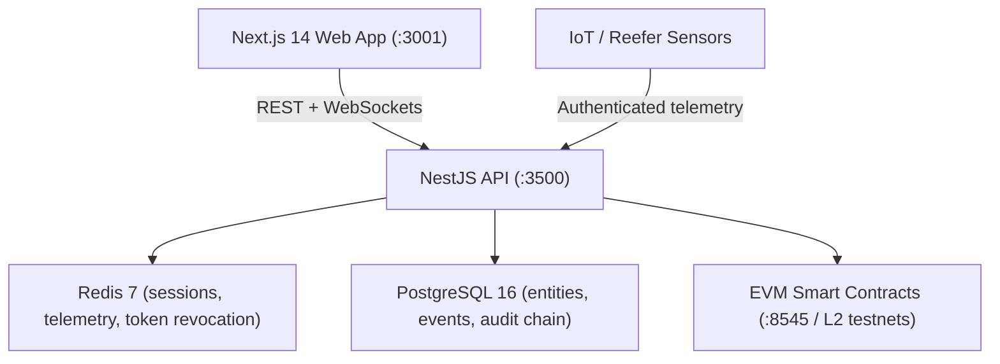

# PharmaTrace: Decentralized Pharmaceutical Track-and-Trace Platform

[](LICENSE)
[](https://www.typescriptlang.org/)
[](https://nestjs.com/)
[](https://nextjs.org/)
[](https://soliditylang.org/)
[](https://www.gs1.org)

PharmaTrace is an enterprise-grade pharmaceutical provenance, serialization, and cold-chain monitoring platform. It combines an event-sourced NestJS backend with EVM smart contracts and a Next.js web application, enabling every medicine carton to be tracked from factory synthesis to patient administration.

> **Project status:** This is a demonstration and testnet implementation designed for portfolio and evaluation review. See [Regulatory Alignment](#regulatory-alignment).

**Quick links:** [Demo Guide](DEMO_GUIDE.md) · [Getting Started](#getting-started) · [Architecture](#architecture) · [Roles](#roles)

---

## What It Does

- **Serialize** drug packages with unique GS1 DataMatrix 2D barcodes and EPCIS 2.0 events.
- **Track custody** across manufacturer, logistics distributor, and pharmacy with a distributed saga coordinator that rolls back failed handovers.
- **Monitor cold chain** (2 deg C to 8 deg C) using multi-sensor consensus, with automated carrier slashing on temperature breaches.
- **Prove compliance privately** using Groth16 zero-knowledge proofs with nullifier replay protection.
- **Prevent counterfeits** with ERC-721 physical-digital twins burned upon patient prescription dispensing.
- **Audit actions** through an immutable SHA-256 hash-chained audit trail complying with 21 CFR Part 11 principles.
- **Public verification** enabling any consumer or patient to instantly verify batch authenticity, recall alerts, and active ingredients.

---

## Architecture



**Backend Architecture:** CQRS and event sourcing, distributed custody saga, Merkle batch rollups, multi-sensor consensus, W3C DID / Verifiable Credentials, IPFS document packaging for ePI and CoA certificates, and an off-chain cryptographic ledger.

**Smart Contracts Suite (Solidity 0.8.26, `viaIR`):**

| Contract | Purpose |
| :--- | :--- |
| `PharmaTraceAttestation.sol` | Anchors batch digests and Merkle roots on-chain |
| `PharmaDigitalTwin.sol` | ERC-721 physical-digital twin, burned upon patient dispensing |
| `PharmaEscrowEngine.sol` | Commercial delivery-versus-payment escrow with sensor consensus |
| `CarrierStakingEscrow.sol` | Logistics carrier collateral staking and breach slashing |
| `ColdChainAutomationOracle.sol` | Chainlink Automation upkeep oracle for automated breach execution |
| `PharmaCrossChainBridge.sol` | Chainlink CCIP token messenger for Layer-2 cross-chain twins |
| `PharmaGovernanceTimelock.sol` | Multi-signature regulatory timelock for emergency recalls |
| `PharmaPaymaster.sol` | ERC-4337 Account Abstraction paymaster for gasless operations |
| `ZkColdChainVerifier.sol` | Groth16 zero-knowledge temperature proof verification |
| `PharmaUUPSProxy.sol` | ERC-1967 UUPS proxy implementation for upgradable logic |
| `MockERC20.sol` | Standard ERC-20 collateral token for testnet escrow and staking |

For an in-depth walkthrough of the system flow, see [DEMO_GUIDE.md](DEMO_GUIDE.md).

---

## Stakeholder Roles

PharmaTrace isolates supply chain permissions using strict Role-Based Access Control (RBAC):

| Role | Operational Scope |
| :--- | :--- |
| **Manufacturer** | Commission GS1 serialized batches, sign laboratory QC release, dispatch, and initiate factory quarantine |
| **Distributor** | Inspect container seals, manage cold-chain vaults, monitor live fleet GPS routes, and generate e-BoL manifests |
| **Pharmacy** | Verify inbound manifests, manage dispensary stock, dispense against physician prescriptions, and retire twins |
| **Regulator** | Issue Form 483 inspection citations, enforce nationwide recalls, track adverse events, and review ALCOA+ reports |
| **Customer** | Verify medication authenticity publicly at `/verify` with 2D DataMatrix scanning and active recall warnings |
| **Admin** | Platform governance, stakeholder lifecycle management, hash-chained audit trails, and system health diagnostics |

Pre-configured credentials for every role are documented in [DEMO_GUIDE.md](DEMO_GUIDE.md).

---

## Getting Started

### Prerequisites

- Node.js >= 20.0.0
- PostgreSQL 16 & Redis 7 (or Docker Compose)
- Git

### 1. Clone the Repository

```bash
git clone --recurse-submodules https://github.com/MirEashanZaman/pharma-trace.git
cd pharma-trace
```

### 2. Configure Environment

```bash
cp pharma-trace-backend/.env.example pharma-trace-backend/.env
cp pharma-trace-frontend/.env.example pharma-trace-frontend/.env.local
```

Key environment configurations:

| Variable | Target | Default | Description |
| :--- | :--- | :--- | :--- |
| `PORT` | Backend | `3500` | NestJS server HTTP listening port |
| `DB_HOST` | Backend | `localhost` | PostgreSQL database host |
| `DB_PORT` | Backend | `5432` | PostgreSQL database port |
| `DB_USERNAME` | Backend | `postgres` | Database authentication username |
| `DB_PASSWORD` | Backend | `12345` | Database authentication password |
| `DB_DATABASE` | Backend | `pharma_trace` | Target relational database name |
| `REDIS_HOST` | Backend | `localhost` | Redis caching and session host |
| `REDIS_PORT` | Backend | `6379` | Redis TCP service port |
| `JWT_SECRET` | Backend | `your_secret` | Secret signing key for JWT tokens |
| `RPC_URL` | Backend | `http://127.0.0.1:8545` | EVM JSON-RPC provider endpoint |
| `NEXT_PUBLIC_API_URL` | Frontend | `http://localhost:3500` | Backend API gateway URL for web client |

### 3a. Run with Docker Compose (Recommended)

```bash
docker compose up --build
```

### 3b. Run Manually

**Backend Engine**

```bash
cd pharma-trace-backend
npm install
npm run compile:contract
npm run build
npm run seed
npm run start:dev
```

**Frontend Client** (in a separate terminal)

```bash
cd pharma-trace-frontend
npm install
npm run dev -- -p 3001
```

### Service URLs

| Service | Address |
| :--- | :--- |
| Web Application Portal | http://localhost:3001 |
| REST API Gateway | http://localhost:3500 |
| Swagger OpenAPI Portal | http://localhost:3500/api/docs |
| Container Liveness Probe | http://localhost:3500/health/live |
| Container Readiness Probe | http://localhost:3500/health/ready |

---

## Verification & Automated Test Suites

```bash
# Compile all 11 smart contracts via solc Yul IR pipeline
cd pharma-trace-backend
npm run compile:contract

# Execute backend unit and integration test suite (155 tests passing)
npm run test

# Verify Next.js production compilation
cd ../pharma-trace-frontend
npm run build
```

---

## Regulatory Alignment

PharmaTrace aligns with international pharmaceutical and digital compliance standards:

| Standard | Jurisdiction | Technical Enforcement Mechanism |
| :--- | :--- | :--- |
| **US FDA 21 CFR Part 11** | United States | SHA-256 continuous hash-chained audit trails, `ElectronicSignatureGuard`, and immutable event sourcing |
| **EU GxP Annex 11** | European Union | High-availability Redis caching, container health probes, and audit chain verification |
| **US DSCSA Title II** | United States | GS1-128 / DataMatrix serialization, EPCIS 2.0 JSON-LD events, and on-chain Merkle batch attestations |
| **WHO TRS 961** | Global | Multi-probe medianized consensus, Chainlink automation oracle, and Groth16 zero-knowledge verifier |

---

## Known Architecture Notes

- Zero-Knowledge nullifier proof registry tracks nullifiers in-memory and on-chain for replay protection.
- Demonstrations use simulated IoT reefer telemetry and pre-populated multi-stage supply chain batches.
- Smart contracts can be deployed to local Hardhat nodes or EVM testnets (Sepolia, Arbitrum Sepolia) via provided deployment scripts.

---

## Project Structure

```text
pharma-trace/
├── pharma-trace-backend/    # NestJS API, domain engine, Solidity smart contracts
│   ├── contracts/           # EVM smart contracts (solc 0.8.26 viaIR)
│   ├── scripts/             # Database seeders, contract compilation and deployers
│   └── src/                 # Auth, blockchain, compliance, drugs, events, health, iot, ledger
├── pharma-trace-frontend/   # Next.js 14 App Router web client
│   ├── app/                 # Catalog, dashboard, dispense, escrow, governance, ledger, provenance, staking, standards, verify
│   ├── components/          # Reusable UI components and telemetry widgets
│   └── lib/                 # API client, Web3 connector, and compliance exporters
├── DEMO_GUIDE.md            # Comprehensive demonstration and defense walkthrough
├── docker-compose.yml       # Multi-container orchestration specification
└── LICENSE                  # MIT License
```

---

## Author

Engineered by **Mir Eashan Zaman**.

## License

This project is licensed under the MIT License. See [LICENSE](LICENSE) for details.
