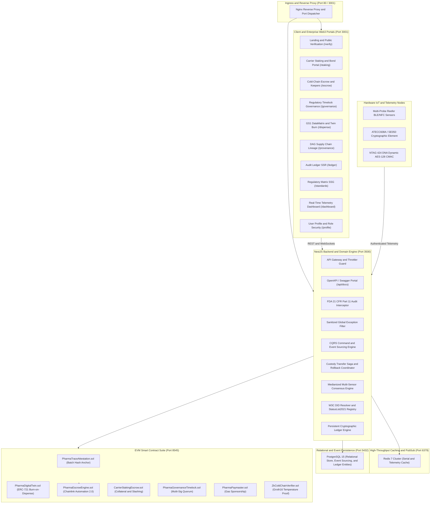

# PharmaTrace-ES: Enterprise Anti-Counterfeit Pharmaceutical Track-and-Trace on Blockchain

PharmaTrace-ES is an enterprise-grade, event-driven pharmaceutical provenance, serialization, and cold-chain compliance platform. The architecture unites Event Sourcing, CQRS, Distributed Saga Custody Handshakes, and EVM Smart Contracts with GS1 EPCIS 2.0 JSON-LD, W3C Decentralized Identifiers (DID), Verifiable Credentials (VC), Groth16 Zero-Knowledge Proofs, Redis Caching, PostgreSQL Persistent Off-Chain Ledger, and automated compliance enforcement.

The platform complies with US FDA 21 CFR Part 11, EU GxP Annex 11, US Drug Supply Chain Security Act (DSCSA), and GS1 standards.

---

## System Architecture



---

## Repository Structure

The platform is organized into decoupled services:

```text
pharma-trace/
├── pharma-trace-backend/              # NestJS Backend, Domain Engine & Smart Contracts
│   ├── contracts/                     # Solidity Hardhat Smart Contracts Suite
│   ├── scripts/                       # Genesis Seeder & Contract Deployment Scripts
│   ├── src/
│   │   ├── auth/                      # Authentication, RBAC & Profile Management
│   │   ├── blockchain/                # EVM Facade, Merkle Batching & Account Abstraction
│   │   ├── common/                    # Global Exception Filters & Audit Interceptors
│   │   ├── compliance/                # SOLID Regulatory Framework Evaluators
│   │   ├── drugs/                     # Drug Serialization & Compliance Dossier Builders
│   │   ├── events/                    # Event Sourcing, CQRS & Custody Saga
│   │   ├── iot/                       # Telemetry Ingestion, Circuit Breakers & Consensus
│   │   ├── ledger/                    # Immutable Cryptographic Hash-Chain Ledger
│   │   ├── mail/                      # Transactional Credential Recovery Service
│   │   ├── redis/                     # In-Memory Telemetry Cache & Fallback
│   │   └── main.ts                    # NestJS Bootstrap, Swagger & Security Middleware
│   ├── package.json
│   └── tsconfig.json
├── pharma-trace-frontend/             # Next.js 14 App Router Web3 Client
│   ├── app/                           # Modular Route Portals
│   │   ├── dashboard/page.tsx         # Custody Operations & Admin Console
│   │   ├── dispense/page.tsx          # Dual-Signature Hospital Dispense
│   │   ├── escrow/page.tsx            # Parametric Cold-Chain Escrow
│   │   ├── governance/page.tsx        # Multi-Sig Regulatory Timelock
│   │   ├── ledger/page.tsx            # Cryptographic Ledger Explorer
│   │   ├── login/page.tsx             # Enterprise JWT & MetaMask Sign-In
│   │   ├── profile/page.tsx           # User Identity & Role Security
│   │   ├── provenance/page.tsx        # Vector Lineage DAG Visualizer
│   │   ├── staking/page.tsx           # Carrier Staking & Slashing Portal
│   │   ├── standards/page.tsx         # Regulatory Compliance Frameworks
│   │   └── verify/page.tsx            # Public Authenticity Verifier & QR Scanner
│   ├── components/                    # Reusable React & DaisyUI/shadcn Components
│   ├── lib/                           # API Client, Web3 Helpers & Utilities
│   ├── package.json
│   └── tailwind.config.ts             # Midnight Navy / Neon Teal Palette Tokens
├── docker-compose.yml                 # Multi-Container Deployment Specification
├── LICENSE                            # MIT License Document
└── README.md                          # Root Monorepo Architecture Specification
```

---

## Core Capabilities and Functional Modules

### 1. Smart Contract Suite (Solidity / Hardhat / EVM)
* **Cryptographic Attestation Anchor (`PharmaTraceAttestation.sol`)**: Anchors SHA-256 batch hashes, custody transfer proofs, and Merkle root trees directly to the Ethereum Virtual Machine.
* **Anti-Counterfeit Physical-Digital Twin (`PharmaDigitalTwin.sol`)**: ERC-721 token representing physical pharmaceutical batches with burn-on-dispense mechanics that permanently destroy serial balance upon patient dispensing.
* **Autonomous Cold-Chain Escrow (`PharmaEscrowEngine.sol`)**: Delivery-vs-payment commercial escrow automated via Chainlink Automation 2.0 Keepers. Releases funds to sellers upon verified temperature compliance or triggers breach refunds to buyers upon excursion breaches.
* **Carrier Collateral Staking and Slashing (`CarrierStakingEscrow.sol`)**: Requires cold-chain logistics carriers to stake ERC-20 collateral bonds per shipment. Slashing triggers automatically on consensus-verified temperature excursions.
* **Regulatory Timelock Governance (`PharmaGovernanceTimelock.sol`)**: OpenZeppelin TimelockController enforcing a 2-of-3 multi-signature quorum across regulatory agencies (FDA, EMA, WHO) with safety delays before executing emergency drug recalls.
* **Zero-Knowledge Privacy Layer (`ZkColdChainVerifier.sol`)**: Groth16 zero-knowledge proof verification confirming temperature readings remained within 2 deg C to 8 deg C boundaries without disclosing formulation data.

### 2. Enterprise Backend Services (NestJS / TypeORM / PostgreSQL)
* **OpenAPI / Swagger 3.0 Documentation Portal**: Accessible at `http://localhost:3500/api/docs` with interactive API discovery and schema validation.
* **Centralized Global Exception Filter**: Sanitizes database query failures and foreign-key constraints (PostgreSQL codes 23505 and 23503), preventing data structure disclosure.
* **FDA 21 CFR Part 11 Audit Logging Interceptor**: Traces every incoming transaction with caller identifier, role, IP address, and execution duration in milliseconds (`X-Response-Time`).
* **Rate Limiting and DDoS Mitigation**: Enforces request quotas across authentication and mutation routes via `@nestjs/throttler`.
* **Immutable Role Enforcement**: Stakeholder roles (`MANUFACTURER`, `DISTRIBUTOR`, `PHARMACY`, `REGULATOR`, `CUSTOMER`) cannot be changed after registration. Administrative accounts are protected against unauthorized self-registration, deletions, and warnings.

### 3. Web3 Frontend Client (Next.js 14 / Tailwind CSS / DaisyUI)
* **Midnight Navy / Neon Teal Design System**: Unified enterprise dark theme (`#0B1220`, `#00D6B4`, `#243247`, `#172638`).
* **Responsive Modular Header Navigation**: Adaptive breakpoints eliminate horizontal screen overflow across desktop, tablet, and mobile devices.
* **Standardized Form Ergonomics**: Clear, descriptive `Enter your...` placeholders across all form elements and modal interfaces.
* **Multi-Format Regulatory Export**: Compiles dynamic audit packages into certified PDF, CSV, and raw JSON formats.

---

## Design System Tokens

| Element | Hex Code | Utility Purpose |
|---|---|---|
| Background Base | `#0B1220` | Monolithic application background |
| Surface Panels | `#172638` | Card containers, modals, and navigation dropdowns |
| Surface Subtle | `#243247` | Interactive input fields and active states |
| Border Default | `#304257` | Structural panel dividers and table boundaries |
| Accent Neon | `#00D6B4` | Primary actions, branding, and verified status pills |
| Accent Hover | `#00b89a` | Button hover and active states |
| Text Primary | `#F1F5F9` | High-contrast typography |
| Text Muted | `#94A3B8` | Metadata, timestamps, and input labels |

---

## Quickstart Guide

### 1. Clone Repositories

```bash
git clone --recurse-submodules https://github.com/MirEashanZaman/pharma-trace.git
cd pharma-trace
```

### 2. Backend Setup and Seeding

```bash
cd pharma-trace-backend
npm install
npm run build
npm run seed
npm run start:dev
```
*Backend API initializes on `http://localhost:3500`.*
*Swagger documentation initializes on `http://localhost:3500/api/docs`.*

### 3. Frontend Setup

```bash
cd ../pharma-trace-frontend
npm install
npm run dev -- -p 3001
```
*Frontend application initializes on `http://localhost:3001`.*

---

## Verification Test Commands

```bash
# Backend unit tests and design pattern validations
cd pharma-trace-backend
npm run test

# Frontend production compilation check
cd ../pharma-trace-frontend
npm run build
```

---

## License

This software is released under the MIT License. See the [LICENSE](LICENSE) file for complete terms.
