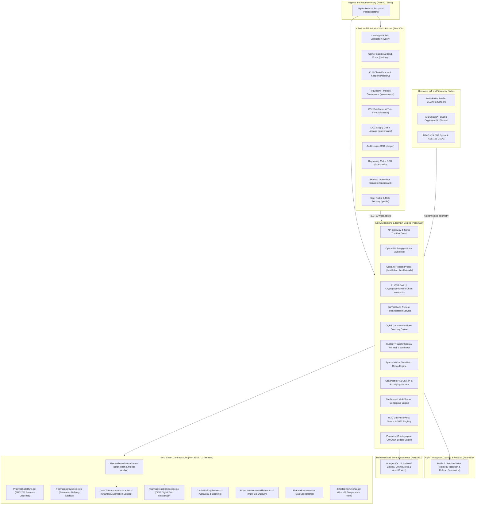

# PharmaTrace: Enterprise Decentralized Pharmaceutical Track-and-Trace Platform

[](LICENSE)
[](https://www.typescriptlang.org/)
[](https://nestjs.com/)
[](https://nextjs.org/)
[](https://soliditylang.org/)
[](https://github.com/MirEashanZaman/pharma-trace)
[](https://www.fda.gov)
[](https://www.gs1.org)

PharmaTrace is an enterprise-grade, event-driven pharmaceutical provenance, serialization, and cold-chain compliance platform. The architecture unites Event Sourcing, CQRS, Distributed Saga Custody Handshakes, and EVM Smart Contracts with GS1 EPCIS 2.0 JSON-LD, W3C Decentralized Identifiers (DID), Verifiable Credentials (VC), Groth16 Zero-Knowledge Proofs, ERC-4337 Account Abstraction, Chainlink Automation, Redis Caching, and automated regulatory compliance enforcement.

The system complies with US FDA 21 CFR Part 11, EU GxP Annex 11, US Drug Supply Chain Security Act (DSCSA Title II), and WHO TRS 961 guidelines.

---

## Interactive Presentation & Defense Guide

For an end-to-end walkthrough across all stakeholder roles, seed data profiles, and presentation scripts, refer to the [DEMO_GUIDE.md](DEMO_GUIDE.md).

---

## System Architecture



---

## Role-Based Workflows & Stakeholder Personas

PharmaTrace isolates supply chain permissions using strict Role-Based Access Control (RBAC) across six stakeholder tiers:

| Stakeholder Role         | Access Scope                                                | Operational Responsibilities                                                                                                                                                            |
| :----------------------- | :---------------------------------------------------------- | :-------------------------------------------------------------------------------------------------------------------------------------------------------------------------------------- |
| **Manufacturer**         | Commissioning, Bulk Serialization, QC Disposition, Dispatch | Commissions unique GS1 DataMatrix identifiers, signs laboratory purity/pH release certificates, initiates cold-chain custody pipelines, and quarantines unstable lots.                  |
| **Distributor**          | Logistics & Fleet Operations, Reefers, Manifests            | Inspects inbound container seals, manages 2 deg C - 8 deg C vault zones, assigns reefer vehicles, monitors live GPS routes, and generates electronic Bills of Lading (e-BoL).           |
| **Pharmacy**             | Dispensary, Prescription Dispensing, Drug Retirement        | Verifies inbound shipments against distributor e-BoL manifests, dispenses medication against physician prescription tokens, and decommissions digital twins upon patient handover.      |
| **Regulator**            | Compliance Audits, Recalls, Pharmacovigilance               | Issues FDA Form 483 facility inspection citations, enforces nationwide Class I/II/III recalls, tracks Adverse Drug Events (ADEs), and runs automated ALCOA+ data integrity analysis.    |
| **Customer**             | Public Verification Portal (`/verify`)                      | Scans 2D DataMatrix packaging barcodes to verify authenticity, active pharmaceutical ingredients, expiry dates, and real-time recall status without accessing private operational data. |
| **System Administrator** | Platform Governance, Health Probes, Audit Trails            | Manages enterprise stakeholder identities, inspects cryptographic hash-chained audit trails, reviews container telemetry, and monitors smart contract gas sponsorship.                  |

---

## Core Capabilities and Architecture Modules

### 1. Smart Contract Suite (Solidity / solc 0.8.26 / viaIR)

- **Autonomous Upkeep Oracle (`ColdChainAutomationOracle.sol`)**: Autonomous Chainlink upkeep contract executing programmatic slashing on `CarrierStakingEscrow.sol` upon verifiable sensor excursion breaches.
- **Cross-Chain Interoperability (`PharmaCrossChainBridge.sol`)**: Cross-Chain Interoperability Protocol (CCIP) token messenger bridging physical-digital twins across EVM Layer-2 rollups with anti-duplication single-custody guarantees.
- **Cryptographic Attestation Anchor (`PharmaTraceAttestation.sol`)**: Anchors Keccak-256 batch digests, Merkle root trees, and custody transition states directly to Ethereum Sepolia and Arbitrum.
- **Anti-Counterfeit Digital Twin (`PharmaDigitalTwin.sol`)**: ERC-721 token representing physical medicine packages featuring burn-on-dispense mechanics to permanently prevent counterfeit packaging reuse.
- **Parametric Delivery Escrow (`PharmaEscrowEngine.sol`)**: Commercial delivery-versus-payment settlement automating fund disbursement or buyer breach refunds based on multi-sensor consensus.
- **Carrier Staking & Slashing (`CarrierStakingEscrow.sol`)**: Logistics carriers deposit ERC-20 collateral bonds per shipment with automated forfeiture if temperature excursions breach GxP tolerances.
- **Regulatory Multi-Sig Governance (`PharmaGovernanceTimelock.sol`)**: Multi-signature timelock contract enforcing dual-quorum approvals across health authorities for emergency product recalls.
- **Zero-Knowledge Privacy Verifier (`ZkColdChainVerifier.sol`)**: Groth16 zero-knowledge verifier proving cold-chain temperature compliance within 2 deg C to 8 deg C without revealing formulations or route secrets.
- **Account Abstraction Paymaster (`PharmaPaymaster.sol`)**: ERC-4337 gas sponsorship paymaster validating UserOperations to enable gasless transactions for warehouse operators.

### 2. Backend Domain Engine (NestJS 11 / TypeORM / PostgreSQL 16 / Redis 7)

- **Distributed Saga Custody Coordinator**: Manages multi-step physical custody handshakes with automated compensating rollback transactions to prevent orphaned shipments during transit failures.
- **ZK-SNARK Nullifier Registry**: Tracks spent cryptographic proof nullifiers in memory and on-chain to block proof-replay attacks on temperature compliance attestations.
- **Dual-Gated Security Pipeline**: Authenticates clients via HttpOnly SameSite Secure cookies with automatic fallback to Bearer authorization headers for external microservices.
- **Automated ALCOA+ Audit Engine**: Evaluates records against FDA 21 CFR Part 11 and EU Annex 11 principles (Attributable, Legible, Contemporaneous, Original, Accurate).
- **21 CFR Part 11 Cryptographic Audit Trail**: SHA-256 continuous hash-chained ledger storing immutable operator actions with verification via `GET /compliance/audit/verify-chain`.
- **High-Performance Composite Indexing**: Targeted database indexes for `(status, expiryDate)` (FEFO inventory) and `(drugSerialNumber, createdAt)` (provenance lookups).
- **Tiered Rate Limiting & DoS Protection**: Tiered throttler guards protecting sensitive authentication, serialization, and regulatory endpoints from brute-force abuse.
- **Container Health Probes**: Native `/health/live` and `/health/ready` endpoints verifying database connection pools, Redis latency, heap allocations, and process uptime.

### 3. Web3 Frontend Client (Next.js 14 App Router / Tailwind CSS / DaisyUI)

- **Midnight Navy & Neon Teal Design System**: Built exclusively with Tailwind CSS and DaisyUI (`#0B1220`, `#00D6B4`, `#243247`, `#172638`).
- **Interactive Provenance DAG**: Dynamic SVG directed acyclic graph visualizer mapping raw ingredient lots, packaging milestones, and custody transitions.
- **GS1 2D DataMatrix Suite**: Built-in 2D barcode generation, camera QR scanning, audio verification feedback, and multi-format compliance exports (PDF, CSV, JSON).
- **Live Fleet & Reefer Telemetry**: Interactive map tracking vehicle GPS positions, door seal status, and thermal metrics in real time.
- **WCAG High-Contrast Accessibility**: Semantic ARIA tags, screen-reader labels, and WCAG AA contrast compliance across all dashboards.

---

## Design System Palette

| Element         | Hex Code  | Purpose                                         |
| :-------------- | :-------- | :---------------------------------------------- |
| Background Base | `#0B1220` | Core application background canvas              |
| Surface Primary | `#172638` | Container panels, modals, and dropdown surfaces |
| Surface Subtle  | `#243247` | Interactive input fields and active cards       |
| Border Default  | `#304257` | Structural panel dividers and table boundaries  |
| Accent Neon     | `#00D6B4` | Primary actions, branding, and verified badges  |
| Accent Hover    | `#00b89a` | Button hover and active states                  |
| Text Primary    | `#F1F5F9` | High-contrast typography                        |
| Text Muted      | `#94A3B8` | Metadata, timestamps, and secondary labels      |

---

## Monorepo Structure

```text
pharma-trace/
├── pharma-trace-backend/              # NestJS Application, Domain Engine & Smart Contracts
│   ├── contracts/                     # Solidity EVM Smart Contracts (viaIR: true)
│   │   ├── CarrierStakingEscrow.sol   # Logistics Carrier Collateral & Slashing
│   │   ├── ColdChainAutomationOracle.sol # Chainlink Automation Upkeep Oracle
│   │   ├── PharmaCrossChainBridge.sol # CCIP Cross-Chain Token Messenger
│   │   ├── PharmaDigitalTwin.sol      # ERC-721 Digital Twin (Burn-on-Dispense)
│   │   ├── PharmaEscrowEngine.sol     # Delivery-vs-Payment Commercial Escrow
│   │   ├── PharmaGovernanceTimelock.sol # Multi-Sig Regulatory Timelock
│   │   ├── PharmaPaymaster.sol        # ERC-4337 Account Abstraction Paymaster
│   │   ├── PharmaTraceAttestation.sol # On-Chain Attestation & Merkle Root Anchor
│   │   └── ZkColdChainVerifier.sol    # Groth16 Zero-Knowledge Verification
│   ├── scripts/                       # Seeders, Deployers & Compilation Pipelines
│   ├── src/
│   │   ├── auth/                      # JWT, HttpOnly Cookies, Web3 & Throttled Auth
│   │   ├── blockchain/                # EVM Facade, ZK Engine, Account Abstraction & Subgraphs
│   │   ├── common/                    # Zod Config, E-Signature & Chained Audit Guards
│   │   ├── compliance/                # Regulatory Frameworks & ALCOA+ Audit Engine
│   │   ├── drugs/                     # Drug Serialization & Multi-Stage Lifecycle
│   │   ├── events/                    # Event Sourcing, CQRS & Distributed Custody Sagas
│   │   ├── health/                    # Container Liveness & Readiness Health Probes
│   │   ├── iot/                       # Telemetry Streams, Circuit Breakers & Consensus
│   │   ├── ledger/                    # Off-Chain Cryptographic Hash-Chain Ledger
│   │   └── main.ts                    # Bootstrap, Security Middleware & Validation
│   ├── Dockerfile                     # Multi-Stage Unprivileged Non-Root Docker Build
│   └── package.json
├── pharma-trace-frontend/             # Next.js 14 App Router Web3 Application
│   ├── app/                           # Modular Application Routes
│   │   ├── catalog/page.tsx           # Pharmaceutical Catalog & FEFO Expiry
│   │   ├── dashboard/page.tsx         # Modular Custody Operations Console
│   │   ├── dispense/page.tsx          # Dual-Signature Hospital Dispense
│   │   ├── escrow/page.tsx            # Parametric Cold-Chain Escrow Portal
│   │   ├── governance/page.tsx        # Multi-Sig Regulatory Timelock Portal
│   │   ├── ledger/page.tsx            # Cryptographic Ledger Explorer
│   │   ├── login/page.tsx             # Demo Personas & MetaMask Web3 Login
│   │   ├── profile/page.tsx           # User Identity & Role Security
│   │   ├── provenance/page.tsx        # Vector Lineage DAG Visualizer
│   │   ├── staking/page.tsx           # Carrier Staking & Slashing Console
│   │   ├── standards/page.tsx         # Regulatory Compliance Frameworks
│   │   └── verify/page.tsx            # Public Authenticity Verifier & QR Scanner
│   ├── components/                    # Reusable React & DaisyUI/Tailwind Components
│   ├── lib/                           # API Client, Web3 Helpers & Compliance Exporters
│   ├── Dockerfile                     # Multi-Stage Non-Root Standalone Docker Build
│   └── package.json
├── DEMO_GUIDE.md                      # Comprehensive Demonstration & Defense Manual
├── docker-compose.yml                 # Multi-Container Orchestration Specification
├── LICENSE                            # MIT License Document
└── README.md                          # Root Monorepo Architecture Specification
```

---

## Getting Started

### Prerequisites

- Node.js >= 20.0.0
- PostgreSQL 16 & Redis 7
- Docker & Docker Compose (optional for containerized deployments)

### 1. Clone the Monorepo

```bash
git clone --recurse-submodules https://github.com/MirEashanZaman/pharma-trace.git
cd pharma-trace
```

### 2. Backend Initialization & Seeding

```bash
cd pharma-trace-backend
npm install
npm run compile:contract
npm run build
npm run seed
npm run start:dev
```

- REST API: `http://localhost:3500`
- Swagger Documentation: `http://localhost:3500/api/docs`
- Health Liveness Probe: `http://localhost:3500/health/live`
- Health Readiness Probe: `http://localhost:3500/health/ready`

### 3. Frontend Client Initialization

```bash
cd ../pharma-trace-frontend
npm install
npm run dev -- -p 3001
```

- Web Application: `http://localhost:3001`

---

## Verification & Automated Test Suites

```bash
# Compile all 13 smart contracts via solc Yul IR pipeline
cd pharma-trace-backend
npm run compile:contract

# Execute backend unit and integration test suite (155 tests)
npm run test

# Verify Next.js production compilation
cd ../pharma-trace-frontend
npm run build
```

---

## Regulatory Compliance Matrix

| Regulation                | Jurisdiction   | Technical Enforcement Mechanism                                                                         |
| :------------------------ | :------------- | :------------------------------------------------------------------------------------------------------ |
| **US FDA 21 CFR Part 11** | United States  | SHA-256 continuous hash-chained audit trails, `ElectronicSignatureGuard`, and immutable event sourcing. |
| **EU GxP Annex 11**       | European Union | High-availability Redis caching, container health probes, and audit chain verification.                 |
| **US DSCSA Title II**     | United States  | GS1-128 / DataMatrix serialization, EPCIS 2.0 JSON-LD events, and on-chain Merkle batch attestations.   |
| **WHO TRS 961**           | Global         | Multi-probe medianized consensus, Chainlink automation oracle, and Groth16 zero-knowledge verifier.     |

---

## Author & Engineering Credits

Designed and developed by **Mir Eashan Zaman** as an enterprise-grade decentralized pharmaceutical supply chain and compliance platform.

---

## License

This project is licensed under the MIT License. See [LICENSE](LICENSE) for details.
