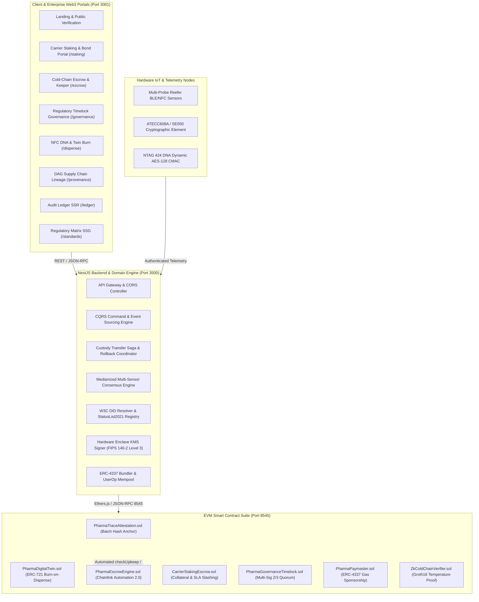

# PharmaTrace-ES: Enterprise Anti-Counterfeit Pharmaceutical Track-and-Trace on Blockchain

PharmaTrace-ES is an enterprise-grade, event-driven pharmaceutical provenance and cold-chain compliance platform. The architecture unites **Event Sourcing**, **CQRS**, **Distributed Saga Custody Handshakes**, and **EVM Smart Contracts** with **ERC-4337 Account Abstraction**, **Chainlink Automation 2.0 Keepers**, **GS1 EPCIS 2.0 JSON-LD**, **W3C Decentralized Identifiers (DID) / Verifiable Credentials (VC)**, and **Groth16 Zero-Knowledge Proofs (ZK-SNARK)**.

---

## System Architecture



---

## Core Platform Capabilities

### 1. Smart Contract Suite (Solidity / Hardhat / EVM)
* **Cryptographic Attestation Anchor (`PharmaTraceAttestation.sol`)**: Anchors SHA-256 batch hashes, custody transfer proofs, and Merkle root trees directly to the Ethereum Virtual Machine.
* **Anti-Counterfeit Physical-Digital Twin (`PharmaDigitalTwin.sol`)**: ERC-721 token representing physical pharmaceutical batches with anti-counterfeiting burn-on-dispense mechanics that permanently destroy serial balance upon patient dispensing.
* **Autonomous Cold-Chain Escrow (`PharmaEscrowEngine.sol`)**: Delivery-vs-payment commercial escrow automated via Chainlink Automation 2.0 Keepers. Releases funds to sellers upon verified temperature compliance or triggers breach refunds to buyers upon excursion breaches.
* **Carrier Collateral Staking & Slashing (`CarrierStakingEscrow.sol`)**: Requires cold-chain logistics carriers to stake ERC-20 collateral bonds per shipment. Slashing triggers automatically on consensus-verified temperature excursions to indemnify manufacturers directly on-chain.
* **Regulatory Timelock Governance (`PharmaGovernanceTimelock.sol`)**: OpenZeppelin TimelockController enforcing a 2-of-3 multi-signature quorum across regulatory agencies (FDA, EMA, WHO) with safety delays before executing emergency drug recalls.
* **Gasless Account Abstraction (`PharmaPaymaster.sol`)**: ERC-4337 corporate paymaster sponsoring transaction gas fees for authenticated supply chain operators, hospitals, and pharmacies.
* **Zero-Knowledge Privacy Layer (`ZkColdChainVerifier.sol`)**: Groth16 zero-knowledge proof verification confirming temperature readings remained within 2°C to 8°C boundaries without disclosing formulation data.

### 2. Standards & Interoperability
* **GS1 EPCIS 2.0 JSON-LD CBV**: Standardized supply chain event schemas (ObjectEvent, AggregationEvent, TransactionEvent) canonicalized with deterministic SHA-256 hash anchoring for FDA DSCSA compliance.
* **GS1 Digital Link 1.2**: Web URI resolver linking 2D data matrix barcodes (`/01/{gtin}/21/{serial}`) to RFC 9264 linksets (e-Leaflets, Certificate of Analysis, Digital Twin on-chain authenticity).
* **W3C Decentralized Identifiers (DID) & Verifiable Credentials (VC)**: Resolves `did:ethr` and `did:key` identifiers with W3C StatusList2021 on-chain bitstring revocation registry for Qualified Person (QP) batch release certification.
* **Dynamic NFC Cryptographic Authentication**: Validates NTAG 424 DNA secure unique NFC tokens with dynamic AES-128 CMAC digests and strictly monotonic counter progression.

### 3. Resilience, Fault Tolerance & Enterprise Patterns
* **Medianized Multi-Sensor Consensus**: Evaluates multi-probe telemetry clusters across reefer transit via statistical median filtering, isolating sensor faults without aborting legitimate commercial delivery escrows.
* **Cloud Hardware Security Module (HSM) KMS Signer**: Enterprise cryptographic key management delegating transaction signing to FIPS 140-2 Level 3 hardware security modules (AWS KMS, Google Cloud KMS, Azure Key Vault, HashiCorp Vault).
* **Custody Transfer Saga & Compensating Rollback**: Orchestrates distributed custody transitions across supply chain roles with automated rollback into compensatory regulatory states (`QUARANTINED`, `RETURN_TO_MANUFACTURER`).

---

## Repository Structure

```text
pharma-trace/
│
├── ran.bat                                    # 1-Click Orchestration Launcher (Hardhat, Backend, Frontend, Chrome)
├── README.md                                  # Enterprise Platform Specification
│
├── pharma-trace-backend/                      # NestJS API, CQRS/Saga & Smart Contracts Layer
│   ├── contracts/                             # Solidity Smart Contracts Suite
│   │   ├── PharmaTraceAttestation.sol         # Cryptographic batch & custody attestation anchor
│   │   ├── PharmaDigitalTwin.sol              # ERC-721 physical-digital twin with burn-on-dispense
│   │   ├── PharmaEscrowEngine.sol             # Chainlink Automation 2.0 commercial delivery escrow
│   │   ├── CarrierStakingEscrow.sol           # Carrier collateral staking & dynamic SLA bond slashing
│   │   ├── PharmaGovernanceTimelock.sol       # Multi-sig regulatory timelock (2/3 quorum)
│   │   ├── PharmaPaymaster.sol                # ERC-4337 gas sponsorship paymaster
│   │   └── ZkColdChainVerifier.sol            # Groth16 Zero-Knowledge cold-chain proof verifier
│   ├── test/                                  # Hardhat smart contract test suites (86 tests)
│   ├── src/
│   │   ├── blockchain/                        # Web3, Ethers.js, Bundler, KMS, DID, VC, and Escrow modules
│   │   ├── compliance/                        # SOLID Architectural Compliance Engine
│   │   ├── drugs/                             # Serialization and Batch Registration Module
│   │   ├── events/                            # Event Sourcing & Custody Saga Engine
│   │   ├── iot/                               # IoT Telemetry, Circuit Breaker, & Sensor Consensus
│   │   ├── ledger/                            # Immutable Hash-Chain Verification Layer
│   │   ├── main.ts                            # NestJS Application Entrypoint (Port 3500)
│   │   └── patterns.spec.ts                   # Enterprise architecture unit test suite (129 tests)
│   ├── hardhat.config.js                      # Hardhat EVM compiler & network configuration
│   └── package.json
│
└── pharma-trace-frontend/                     # Next.js 14 App Router Web3 Interface
    ├── app/
    │   ├── page.tsx                           # Landing page & public verification portal
    │   ├── staking/                           # Carrier Collateral Staking & Bond Portal
    │   ├── escrow/                            # Cold-Chain Escrow & Chainlink Relayer Portal
    │   ├── governance/                        # Multi-Sig Regulatory Timelock Governance Portal
    │   ├── dispense/                          # NFC DNA Authentication & Digital Twin Burn Portal
    │   ├── provenance/                        # Interactive DAG Supply Chain Lineage Graph
    │   ├── ledger/                            # SSR Immutable Cryptographic Ledger
    │   ├── catalog/                           # ISR Dynamic Drug Serialization Catalog
    │   ├── standards/                         # SSG Regulatory Compliance Framework Matrix
    │   ├── dashboard/                         # Real-Time Telemetry & Custody Ingestion Dashboard
    │   └── verify/                            # Consumer & Hospital Authenticity Verification Portal
    ├── components/
    │   └── navigation.tsx                     # Enterprise Navigation Bar (Midnight Navy / Neon Teal)
    ├── lib/
    │   └── api.ts                             # Axios Web3 Client SDK & Ethers.js Integration
    ├── tailwind.config.ts                     # Midnight Navy & Neon Teal Design System (#0B1220, #00D6B4)
    └── package.json
```

---

## Web3 Portals & Route Matrix

| Route | Rendering Mode | Purpose | Target Stakeholder |
|---|---|---|---|
| `/staking` | Client-Side (CSR) | Carrier collateral deposits, SLA bond locking, and consensus-driven bond slashing with manufacturer indemnity. | Cold-Chain Logistics Carriers & Manufacturers |
| `/escrow` | Client-Side (CSR) | Commercial delivery payment escrow, Chainlink Automation 2.0 relayer control, and ERC-4337 Paymaster simulation. | Financial Auditing & Commercial Buyers |
| `/governance` | Client-Side (CSR) | OpenZeppelin Timelock multi-sig proposal queue, guardian signature quorum, and emergency product recall execution. | Regulatory Agencies (FDA, EMA, WHO) |
| `/dispense` | Client-Side (CSR) | NTAG 424 DNA dynamic NFC validation, GS1 Digital Link resolution, and ERC-721 digital twin burn on patient dispense. | Hospital & Retail Pharmacists |
| `/provenance` | Client-Side (CSR) | Directed Acyclic Graph (DAG) visualizing complete batch lineage, custody handshakes, and checkpoint telemetry. | Supply Chain Directors & Quality Auditors |
| `/ledger` | Server-Side (SSR) | Immutable cryptographic hash-chain inspection with real-time on-chain Merkle root validation. | Compliance Officers & Inspectors |
| `/catalog` | Incremental (ISR) | Pharmaceutical inventory catalog with on-chain attestation status and batch serialization parameters. | Enterprise Distributors & Wholesalers |
| `/standards` | Static (SSG) | Full regulatory framework matrix (FDA 21 CFR Part 11, EU GMP Annex 11, WHO TRS 961, US DSCSA Title II). | Regulatory Affairs & Legal Teams |
| `/dashboard` | Client-Side (CSR) | Real-time sensor telemetry stream, GPS cartography, and temperature threshold circuit breaker. | Warehouse Operators & Fleet Dispatchers |
| `/verify` | Client-Side (CSR) | Consumer-facing instant authenticity verification using serial numbers or 2D data matrix QR codes. | Patients & Healthcare Providers |

---

## Port & Runtime Architecture

| Service | Port | Protocol | Purpose |
|---|---|---|---|
| **Hardhat EVM Local Node** | `8545` | JSON-RPC / HTTP | Local Ethereum execution client hosting smart contracts. |
| **PharmaTrace Backend API** | `3500` | REST / WebSocket | NestJS application handling event sourcing, DID resolution, and contract orchestration. |
| **PharmaTrace Frontend Web App** | `3001` | HTTP / React Next.js 14 | Responsive web interface running the Midnight Navy / Neon Teal design system. |

---

## Quickstart & Launch Guide

### 1-Click Startup (Recommended for Windows)

Double-click or run [ran.bat](file:///e:/D/SADP/pharma-trace/ran.bat) from the repository root:

```cmd
ran.bat
```

This single command orchestrates:
1. Launches Hardhat EVM Node on `http://127.0.0.1:8545`.
2. Launches Backend API Server on `http://localhost:3500`.
3. Launches Frontend Web App on `http://localhost:3001`.
4. Automatically opens `http://localhost:3001` in Google Chrome.

---

### Manual Launch

#### 1. Start Hardhat EVM Blockchain Node
```bash
cd pharma-trace-backend
npx hardhat node
```
*Node starts on `http://127.0.0.1:8545`.*

#### 2. Start Backend API Server
```bash
cd pharma-trace-backend
npm install
npm run start:dev
```
*API Server starts on `http://localhost:3500`.*

#### 3. Start Frontend Web Interface
```bash
cd pharma-trace-frontend
npm install
npm run dev -- -p 3001
```
*Frontend Web App starts on `http://localhost:3001`.*

---

## Verification & Test Suites

The platform includes full automated verification across smart contracts and backend application services:

### Smart Contract Test Suite (Hardhat)
```bash
cd pharma-trace-backend
npm run test:contracts
```
*Passes all 86 unit and integration tests across all 6 smart contracts (`PharmaTraceAttestation`, `PharmaDigitalTwin`, `PharmaEscrowEngine`, `CarrierStakingEscrow`, `PharmaGovernanceTimelock`, `PharmaPaymaster`, and `ZkColdChainVerifier`).*

### Backend Domain & Architecture Test Suite (Jest)
```bash
cd pharma-trace-backend
npm test
```
*Passes all 129 enterprise pattern unit tests across CQRS, Sagas, IoT consensus, KMS signers, EPCIS 2.0 canonicalization, DID resolution, and ERC-4337 mempool bundler.*

### Frontend Production Compilation (Next.js 14)
```bash
cd pharma-trace-frontend
npm run build
```
*Compiles all 20 static and dynamic routes with zero TypeScript or build errors.*

**Total Passing Test Suite**: **215 Automated Tests Passing**.

---

## Regulatory Compliance Framework

| Standard | Governing Body | Technical Realization in PharmaTrace |
|---|---|---|
| **21 CFR Part 11** | US FDA | Cryptographic EIP-712 non-repudiation signatures, immutable on-chain hash anchors, and Cloud KMS HSM audit logs. |
| **GMP Annex 11** | European Medicines Agency | Qualified Person (QP) batch release credentials via W3C Verifiable Credentials with on-chain StatusList2021 revocation. |
| **DSCSA Title II** | US FDA | GS1 EPCIS 2.0 JSON-LD event canonicalization, GS1 Digital Link resolver, and parent-child packaging aggregation (Item -> Case -> Pallet). |
| **WHO TRS 961** | World Health Organization | Cold-chain circuit breaker with multi-probe sensor consensus and automated commercial escrow breach refunds. |
| **EU Falsified Medicines Directive** | European Commission | Physical-digital twin NFT with burn-on-dispense mechanics preventing decommissioned medicine re-entry into distribution. |

---

## License

Enterprise Proprietary - PharmaTrace Track-and-Trace Consortium.
